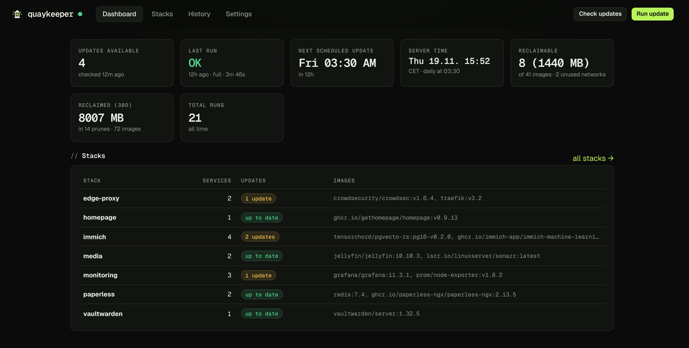

<p align="center">
  <picture>
    <source media="(prefers-color-scheme: dark)" srcset="docs/logo/quaykeeper-lockup-dark.svg">
    
  </picture>
</p>

<p align="center">
  <b>Keeps every container on your quay up to date — while you sleep.</b>
</p>

<p align="center">
  <a href="https://github.com/joshmadison/quaykeeper/actions/workflows/ci.yml"></a>
  <a href="LICENSE"></a>
  
  
</p>

Quaykeeper keeps every Portainer stack on current images without you opening
Portainer. It checks your stacks against their registries, redeploys only what
changed, backs up first, cleans up after itself and keeps a readable record of
every run. Self-hosted — no accounts, no cloud, no telemetry.

<p align="center">
  
</p>
<p align="center">
  <sub>One page answers the three questions that matter: what changed, when did it last run, when does it run next.</sub>
</p>

> [!NOTE]
> Quaykeeper was called **Portainer Update Service** before. Existing
> installs keep working: the old `PUS_*` environment variables are still
> read, and the data volumes kept their names.

## Features

- **Per-service checks, not stack guessing.** Every compose service's image is
  resolved and compared against docker.io and ghcr.io — by tag or digest,
  whichever the reference uses. The badge tells you how long the update has
  been out. Registries that can't be read anonymously are shown as *not
  verified* instead of being guessed at.
- **Scheduled runs you can trust.** Interval, daily or weekly, in the
  container's timezone. Manual runs any time. Repeated failures back off
  instead of hammering your host.
- **Backup → update → verify → repair.** Portainer's datastore is backed up
  before anything changes (a failed backup is recorded and the run carries on),
  unused images and build cache are pruned, changed stacks redeploy in parallel
  and wait until their containers are healthy, then a verification sweep and
  network repairs run.
- **Rollback to the last healthy version.** Pre-update images are snapshotted
  per stack, so a bad release is one click away from being undone.
- **Version pinning with real tags.** Pin a service to a specific tag (or move
  it back to `latest`) and the compose file is edited in Portainer and the
  stack redeployed — no copy-pasting YAML.
- **Cleanup with restraint.** Every run prunes unused images and build cache.
  The **Cleanup** tab shows what else is lying around — leftover images and
  networks — and removes exactly what you pick. Rollback images and networks
  of existing stacks are flagged; stopped containers and volumes are never
  touched.
- **A history that answers questions.** Steps, duration, live log, success
  rate and 30-day reclaimed space. Runs that were cut short by a restart are
  marked *interrupted* instead of being counted as failures.
- **Local by design.** The app talks to your Portainer and the registries you
  already use. Nothing else.

## Quick start

Deploy it as a Portainer stack straight from this repository:

1. **Stacks → Add stack → Repository** — URL `https://github.com/joshmadison/quaykeeper`,
   compose path `docker-compose.yml`
2. Set `QK_LISTEN_HOST=0.0.0.0` and `TZ`. Optionally `QK_AUTH_TOKEN` — if you
   don't, Quaykeeper generates a token on first start and prints it in the log
3. Deploy, open `http://<host>:8090` and enter your Portainer URL and an admin
   API key in **Settings**

Or with docker compose:

```bash
git clone https://github.com/joshmadison/quaykeeper.git
cd quaykeeper && docker compose up -d --build
```

More options and requirements: **[Installation](docs/installation.md)**.

## Documentation

| | |
|---|---|
| **[Installation](docs/installation.md)** | Requirements, Portainer stack, docker compose, local Python |
| **[Usage](docs/usage.md)** | How a run works, stacks, version pinning, rollback, cleanup, history |
| **[Configuration](docs/configuration.md)** | All settings and `QK_*` variables, schedules, updating Portainer itself |
| **[Security](docs/security.md)** | Auth token, CSRF protection, TLS, what leaves your network |
| **[API](docs/api.md)** | Every endpoint, for scripts and dashboards |

## License

MIT — see [LICENSE](LICENSE).
