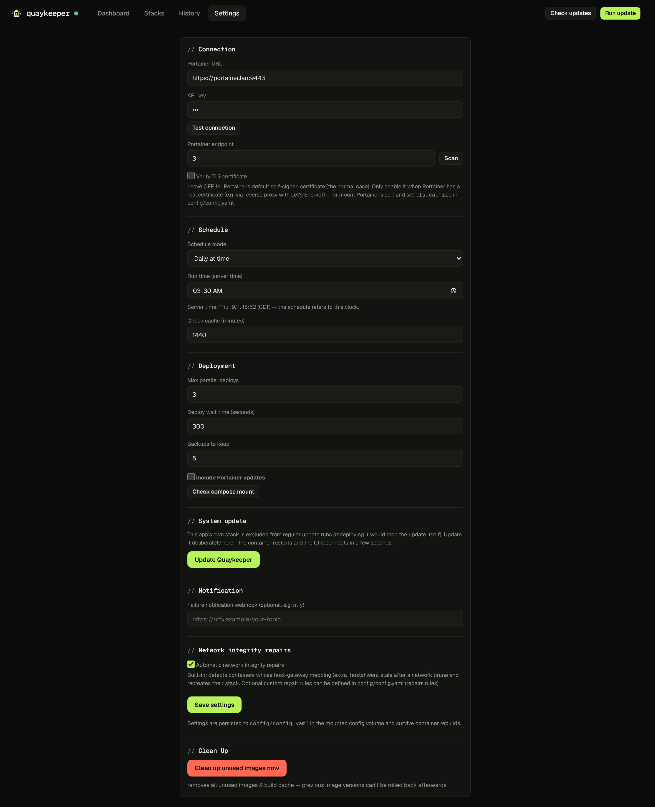

# Configuration

Most people never touch a config file: the UI covers everything and writes
`config/config.yaml` in the mounted config volume. The committed template is
[`config/config.example.yaml`](../config/config.example.yaml), including the
optional custom repair rules.

Every key can also be set as an environment variable with the `QK_` prefix
(`portainer_url` → `QK_PORTAINER_URL`), which is handy for stacks deployed
from Git. The pre-rename prefix `PUS_` still works; if both are set, `QK_`
wins.

| Variable | Default | What it does |
|---|---|---|
| `QK_PORTAINER_URL` | — | Portainer base URL |
| `QK_PORTAINER_API_KEY` | — | Portainer API key (admin) |
| `QK_PORTAINER_ENDPOINT_ID` | auto | Pin an endpoint if auto-detect picks the wrong one |
| `QK_LISTEN_HOST` | `127.0.0.1` | Bind address — **must be `0.0.0.0` in a container** |
| `QK_LISTEN_PORT` | `8090` | Web UI port |
| `QK_AUTH_TOKEN` | — | If set, mutating API calls need `Authorization: Bearer <token>` |
| `QK_UPDATE_SCHEDULE_MODE` | `interval` | `interval`, `daily` or `weekly` |
| `QK_UPDATE_INTERVAL_HOURS` | `168` | Interval mode: hours between runs |
| `QK_UPDATE_SCHEDULE_TIME` | `03:30` | Daily/weekly run time, `HH:MM` |
| `QK_UPDATE_SCHEDULE_DAY` | `0` | Weekly mode: `0` = Monday … `6` = Sunday |
| `QK_TLS_VERIFY` | `false` | Verify Portainer's TLS certificate |
| `QK_TLS_CA_FILE` | — | Path to a CA/cert to verify a self-signed Portainer cert |
| `QK_MAX_PARALLEL_DEPLOYS` | `3` | Stacks redeployed at once |
| `QK_DEPLOY_WAIT_TIME` | `300` | Seconds to wait for containers to become healthy |
| `QK_KEEP_BACKUPS` | `5` | Portainer backups to keep |
| `QK_CHECK_CACHE_MINUTES` | `30` | Registry result cache TTL (respects rate limits) |
| `QK_NOTIFY_WEBHOOK` | — | POST a JSON summary here when a run fails (ntfy-compatible) |
| `QK_INCLUDE_PORTAINER` | `false` | Also update Portainer itself (see below) |
| `QK_REPAIRS_ENABLED` | `true` | Automatic network integrity repairs |

## Schedule and settings

<p align="center">
  
</p>

**Schedule mode** offers `interval` (every N hours), `daily` and `weekly` (at
`HH:MM` in the container's timezone). **Deploy wait time** caps how long each
redeploy waits for Portainer to finish deploying and for its containers to
report healthy. Everything is validated
before it is saved — and if an environment variable exists for a key, it wins.

## Updating Portainer itself (optional)

Portainer is usually started outside Portainer, so updating it needs two extra
mounts in this app's stack:

```yaml
    volumes:
      - /path/to/portainer:/host-portainer:ro          # Portainer's compose dir
      - /var/run/docker.sock:/var/run/docker.sock      # for docker compose
```

Enable **Include Portainer updates** in Settings and press **Check compose
mount** to verify the wiring.

> [!IMPORTANT]
> Relative paths in Portainer's compose file (`./data:/data`, `env_file`) are
> resolved against the directory the project was created in. Quaykeeper reads
> that directory from the running Portainer container and passes it to
> compose, so the host paths stay correct. If it cannot be determined and the
> file uses relative paths, the self-update is skipped instead of risking an
> empty Portainer data directory. Simplest setup: mount the compose directory
> at the **same path** as on the host (`/opt/portainer:/opt/portainer:ro`). A full run then ends with `docker compose pull &&
docker compose up -d` in that directory — after everything else has finished,
so the update doesn't cut its own run short.

Quaykeeper's own stack is excluded from regular runs for the same reason. Use
**Update Quaykeeper** in Settings when you want to move it forward
deliberately.

---

[← Back to README](../README.md) · [Installation](installation.md) · [Usage](usage.md) · [Configuration](configuration.md) · [Security](security.md) · [API](api.md)
