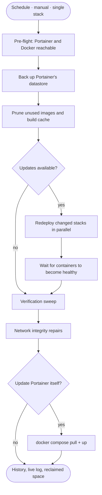
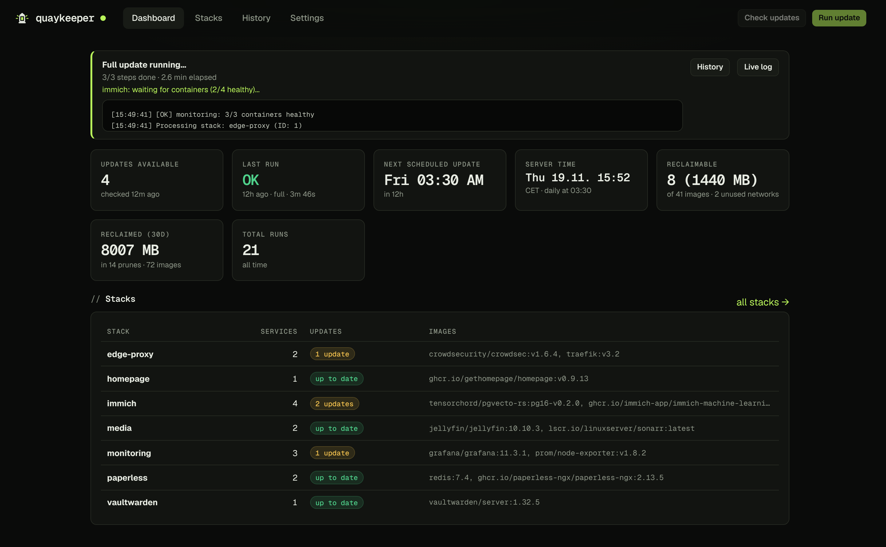
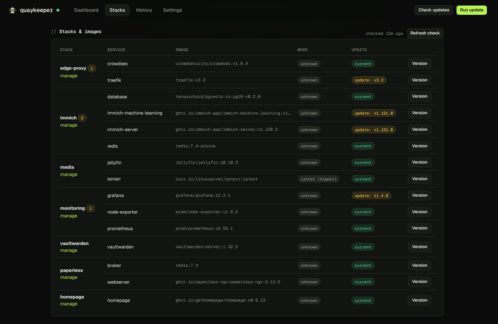
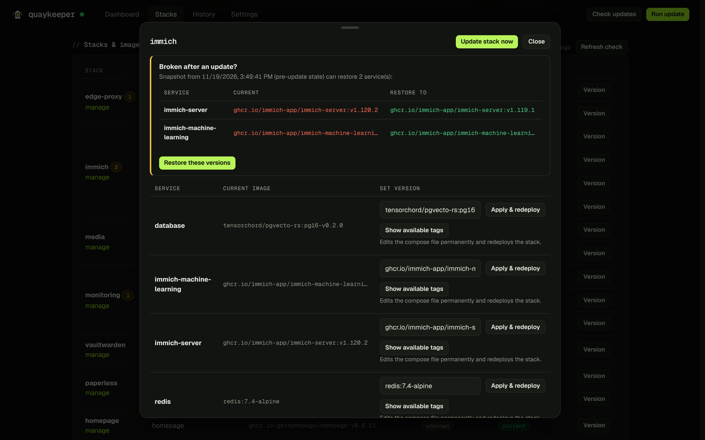
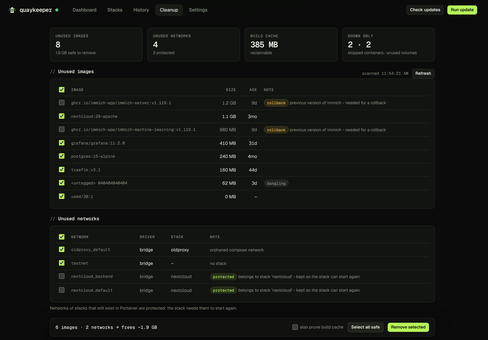
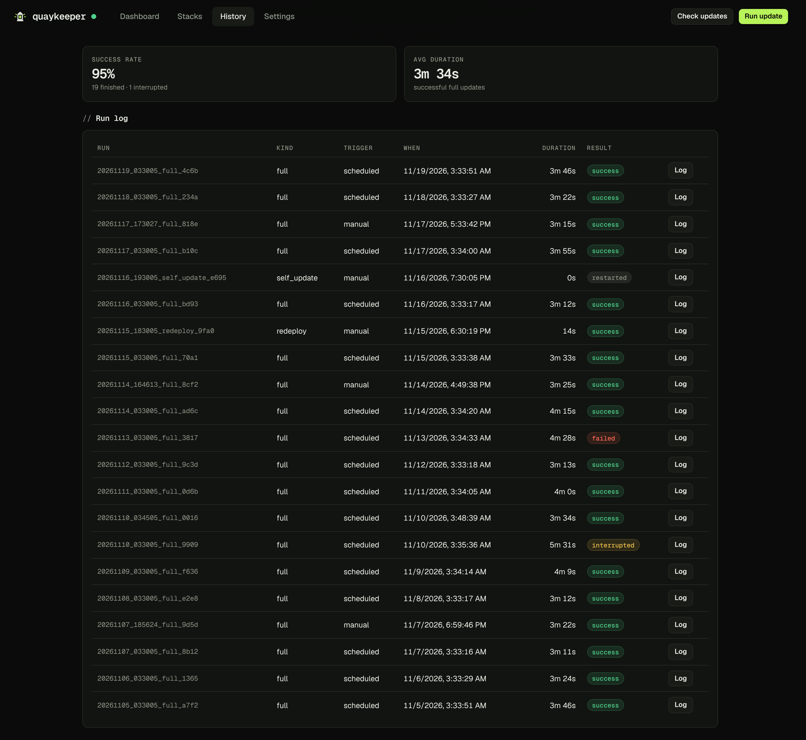

# Usage

## How a run works

While a run is active the dashboard shows the current phase, step progress and
the tail of the log, so you can see what it is doing without leaving the page.

  

  A run in progress: phase, elapsed time and the last log lines, live.

## Stacks

**Stacks** is where the per-service truth lives: image, how it's tracked
(pinned version, digest, …), and whether it's current.

  

**Run update** performs the whole sequence. **Check updates** only refreshes the
badges. One job runs at a time — if something is already going, the app says
so instead of queueing silently.

Open any stack to see its compose file, pin a version, redeploy it alone, or
roll it back.

## Versions and rollback

The sheet behind each stack is also the recovery path. The snapshot strip at the
top shows exactly what a rollback would change, and restoring is a single
button.

  

  Pin a version, redeploy one stack, or restore the images from before the last update.

How the rollback point works:

- It is saved when an update **actually changes** an image of the stack, and
  when you pin a version. A run that changes nothing keeps the previous point.
- It records the exact image that ran, as `repo:tag@sha256:…` — a `:latest`
  stack rolls back to the real previous image, not to whatever `latest` means
  today. After a restore the stack stays pinned to that digest until you pick
  a version again.
- The automatic prune of an update run keeps these images, so a restore never
  has to hope the old version is still on the registry. Only **Prune all
  unused images** in the Cleanup tab removes them, and it says so.
- Stacks deployed from git can't be pinned or rolled back here — the
  repository is the source of truth.

## Cleanup

Every full run already prunes unused images and the build cache. The
**Cleanup** tab is for everything else that piles up over time — and for
removing it on your terms:

  

- **Unused images**, largest first. An image that is the previous version of a
  stack is marked *rollback*: removing it means a rollback has to pull it again.
- **Unused networks.** Networks of stacks that still exist in Portainer are
  *protected* — the stack needs them to start again. Orphaned compose networks
  and hand-made ones are safe.
- **Select all safe** picks everything that is not flagged; the bar shows what
  the selection frees. Optionally prune the build cache with it.
- Items are removed one by one and re-checked first: anything that is in use
  again by then is skipped, and nothing is forced. Each cleanup is a run in the
  history, with its log.
- **Stopped containers** and **unused volumes** are listed, never removed:
  stopped means *intentionally off*, and volumes hold data.

## History

  

Every run — scheduled, manual, redeploy, prune, rollback, self-update — is
recorded with its steps, duration and full log. If the container is restarted
in the middle of a run, that run shows up as **interrupted** with its original
trigger; the success rate only counts runs that actually finished. Reclaimed
space is aggregated over the last 30 days.

---

[← Back to README](../README.md) · [Installation](installation.md) · [Usage](usage.md) · [Configuration](configuration.md) · [Security](security.md) · [API](api.md)
